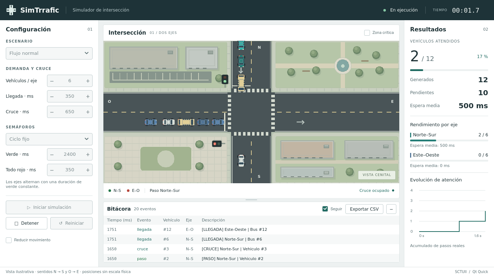

# SimTrrafic

Simulador concurrente de una intersección para Tecnología de Objetos II (SCTUII). El motor está escrito en C++17 y la interfaz de escritorio utiliza Qt Quick/QML. Esta versión **1.3.0** mejora la vista urbana, los controles y la lectura de resultados.



## Abrir en Qt Creator

1. Descomprime el ZIP y abre `CMakeLists.txt`.
2. Selecciona un kit de escritorio **Qt 6.2 o superior**, con Qt Quick, QML, Quick Controls, Layouts y Dialogs. Las pruebas gráficas usan también Qt Test.
3. Configura el proyecto con `BUILD_QT_QUICK=ON`, compila y elige **simtrrafic_qt** como ejecutable.
4. Ejecuta. Todos los componentes visuales están incluidos en los recursos del programa.

Se requiere CMake 3.16 o superior y un compilador C++17. En Windows, usa el compilador correspondiente a tu kit de Qt: MinGW con MinGW, o MSVC con MSVC. Qt Creator configura normalmente las rutas del kit.

Si CMake no encuentra Qt, añade `CMAKE_PREFIX_PATH` apuntando a tu instalación; por ejemplo `C:/Qt/6.8.3/mingw_64`. La ruta es ilustrativa.

## Compilar en Linux

En Debian/Ubuntu, instala los módulos de desarrollo y ejecución:

```bash
sudo apt install build-essential cmake qt6-base-dev qt6-declarative-dev \
  qml6-module-qtquick qml6-module-qtquick-controls qml6-module-qtquick-layouts \
  qml6-module-qtquick-window qml6-module-qtquick-dialogs \
  qml6-module-qtquick-templates qml6-module-qtqml-workerscript

cmake -S . -B build -DCMAKE_BUILD_TYPE=Debug
cmake --build build -j4
ctest --test-dir build --output-on-failure
./build/simtrrafic_qt
```

## Compilar en Windows

Desde la terminal del kit Qt, o usando Qt Creator:

```powershell
cmake -S . -B build -DCMAKE_PREFIX_PATH="C:/Qt/6.8.3/mingw_64"
cmake --build build --config Debug
ctest --test-dir build -C Debug --output-on-failure
```

Con MinGW, el ejecutable suele ser `build/simtrrafic_qt.exe`; con Visual Studio, `build/Debug/simtrrafic_qt.exe`. Para distribuirlo fuera de Qt Creator, usa `windeployqt --qmldir gui/qml` del mismo kit y pasa la ruta del ejecutable.

## Uso

- Selecciona **Flujo bajo**, **Flujo normal** u **Hora punta**. También puedes escribir valores en los campos numéricos o usar sus botones. Los parámetros se bloquean mientras el motor está activo.
- Selecciona ciclo fijo o política adaptativa e inicia. **Detener** solicita el cierre ordenado de los hilos; **Reiniciar** limpia los resultados cuando la ejecución ya terminó.
- Arrastra el separador situado sobre la bitácora para cambiar su altura. El botón **− / +** permite plegarla o recuperarla.
- Activa **Zona crítica** para mostrar su límite. Los estados de ocupación y semáforos proceden del motor.
- **Reducir movimiento** coloca las colas directamente y simplifica la representación del cruce y la salida.
- Desactiva **Seguir** para revisar eventos anteriores. **Exportar CSV** guarda el historial completo, no solo las filas visibles. Los fallos de escritura aparecen en la barra inferior.
- Atajos: **Ctrl+Return** para iniciar y **Ctrl+E** para exportar. Tab y Mayús+Tab recorren los controles; las flechas permiten ajustar campos y seleccionar opciones.

Los autos usan tonos verdes o azules según el eje y los buses tonos arena. El tipo de vehículo es el que informa el dominio; no se deduce del color. Norte–Sur se dibuja de norte a sur y Este–Oeste de oeste a este. Las posiciones son ilustrativas: no representan distancias ni velocidades físicas. La escena no añade giros, agentes peatonales ni direcciones adicionales al motor.

| Parámetro | Predeterminado de consola | Rango |
|---|---:|---:|
| Vehículos por eje | 6 | 1–60 |
| Intervalo de llegada | 90 ms | 10–5000 ms |
| Tiempo de cruce | 130 ms | 20–5000 ms |
| Duración del verde | 1000 ms | 100–10000 ms |
| Transición en rojo | 220 ms | 20–5000 ms |

Los escenarios de la interfaz conservan los tiempos de la entrega anterior, más fáciles de observar que los valores de consola. Al editar la cantidad antes de iniciar, el total previsto se actualiza inmediatamente.

## Consola sin Qt

```bash
cmake -S . -B build-cli -DBUILD_QT_QUICK=OFF
cmake --build build-cli -j4
ctest --test-dir build-cli --output-on-failure
./build-cli/simtrrafic --vehiculos 10 --llegada-ms 70 --cruce-ms 120 --verde-ms 900 --rojo-ms 200
./build-cli/simtrrafic --adaptativo
./build-cli/simtrrafic --help
```

## Organización

| Archivos | Responsabilidad |
|---|---|
| `include/`, `src/Simulador.cpp` | Motor, colas concurrentes, exclusión mutua, políticas y telemetría. |
| `gui/main_quick.cpp` | Arranque del escritorio y carga de recursos QML. |
| `gui/SimulationController.*` | Configuración, hilo de trabajo, estadísticas, bitácora y CSV. |
| `gui/VehicleModel.*` | Posiciones de presentación, separación de colas y etapas reales. |
| `gui/qml/Main.qml`, `Theme.qml` | Distribución y paleta compartida. |
| `gui/qml/components/` | Paneles, controles, entorno urbano, vehículos y semáforos. |
| `tests/` | Pruebas del motor, controlador, modelo visual e interacción QML. |

El controlador consulta instantáneas protegidas por mutex cada 35 ms y actualiza las posiciones aproximadamente cada 16 ms, siempre en el hilo de la interfaz. El simulador y sus cinco hilos internos trabajan por separado. Al cerrar, el controlador cancela y une el hilo de trabajo. Un cruce ya reservado puede tardar hasta el tiempo de cruce configurado antes de terminar.
